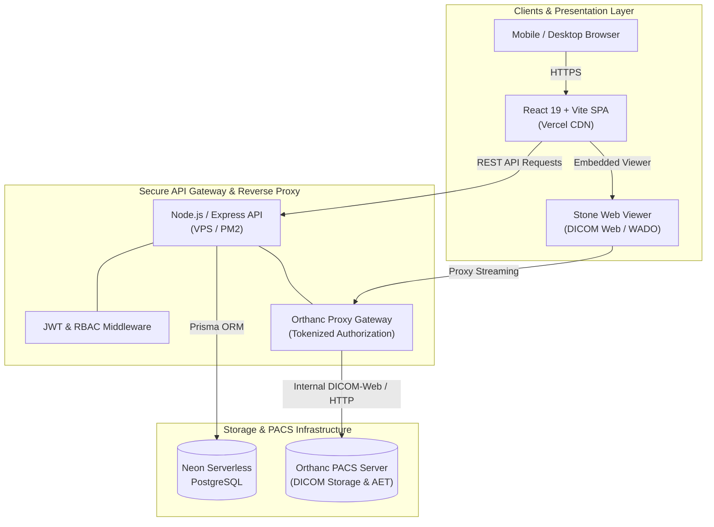

# 🏥 Diagnóstico López — Cloud Medical PACS & DICOM Platform

<div align="center">

[](https://diagnostico-lopez.vercel.app)
[](https://react.dev/)
[](https://nodejs.org/)
[](https://www.postgresql.org/)
[](https://www.prisma.io/)
[](https://www.orthanc-server.com/)
[](https://tailwindcss.com/)

<p align="center">
  <strong>A modern, HIPAA-conscious Full-Stack PACS (Picture Archiving and Communication System) and clinical portal for high-resolution medical imaging, radiologist diagnosis, and secure patient self-service.</strong>
</p>

[Explore Live Demo](https://diagnostico-lopez.vercel.app) • [View Architecture](#-system-architecture) • [Key Features](#-key-features) • [Getting Started](#-getting-started)

</div>

---

## 🌐 Live Production Deployment

| Service | Environment | URL |
| :--- | :--- | :--- |
| **Frontend Web App** | Vercel (CI/CD) | [diagnostico-lopez.vercel.app](https://diagnostico-lopez.vercel.app) |
| **Custom Domain** | Production CDN | [www.diagnosticolopez.com](https://www.diagnosticolopez.com) |
| **Backend & PACS** | Linux VPS (Ubuntu / PM2 / Docker) | Private API Gateway + Orthanc PACS |

<div align="center">
  
  <p><em>Scan with your mobile device to open the live application</em></p>
</div>

---

## 💡 Overview & Problem Solved

Traditional healthcare radiological workflows often rely on printed films, optical discs, or unencrypted email attachments that compromise patient privacy and delay critical treatments.

**Diagnóstico López PACS Platform** resolves this by connecting radiology imaging modalities (X-Ray, Tomography, MRI) directly to an enterprise **Orthanc PACS server**, governed by a secure Node.js API Gateway and an ultra-responsive React SPA with an embedded DICOM web viewer.

### Highlights
- ⚡ **Instant Image Streaming**: Zero-lag viewing of multi-slice DICOM series via WADO-RS and Stone Web Viewer.
- 🛡️ **Zero-Exposure PACS Gateway**: The PACS server is never exposed to the public internet; all requests are authenticated through an Express reverse proxy with short-lived tokens.
- 👥 **Role-Based Access Control (RBAC)**: Distinct, isolated workspaces for Hospital Administrators, Radiologists/Physicians, and Patients.
- 📄 **Diagnostic Reporting**: Built-in editor for clinical findings with automatic cryptographic PDF generation.

---

## 🏛️ System Architecture



---

## ✨ Key Features

### 🩻 1. Web DICOM Medical Viewer
- Embedded clinical DICOM viewer with window leveling (WW/WL presets: bone, soft tissue, lung), zoom, pan, inversion, and measurement tools.
- Multi-series and multi-instance browsing directly inside the browser.
- High-efficiency transfer with native HTTP compression.

### 🔐 2. Enterprise Security & Privacy
- **Strict Role Segregation**:
  - **ADMIN**: Complete patient and doctor management, PACS import audit, study assignment.
  - **DOCTOR**: Access assigned studies, submit clinical diagnostic reports.
  - **PATIENT**: Restricted exclusively to their personal medical history and verified studies.
- **Dynamic Token Verification**: Prevents ID enumeration attacks and study snooping.
- **Zero Sensitive Data in VCS**: Clean configuration templates without hardcoded credentials.

### 📋 3. Digital Clinical Reports
- Radiologists write comprehensive medical findings directly within the dashboard.
- Real-time PDF generation and secure download for patients and referring physicians.

---

## 📂 Project Structure

```text
Radiografia/
├── backend/                  # RESTful API & PACS reverse proxy
│   ├── prisma/               # Database schema & migrations (PostgreSQL)
│   │   ├── migrations/       # Version-controlled migration history
│   │   └── schema.prisma     # Prisma data models (User, Study, Report)
│   ├── src/
│   │   ├── index.js          # Express server initialization
│   │   ├── lib/              # Prisma client singleton
│   │   ├── middleware/       # JWT auth & Orthanc proxy token validation
│   │   ├── routes/           # Domain routes (auth, users, studies, reports, proxy)
│   │   └── services/         # Orthanc client & Resend email integration
│   ├── .env.example          # Backend environment template
│   ├── orthanc.json.example  # Orthanc PACS server configuration template
│   └── README.md             # Dedicated backend documentation
│
├── frontend/                 # Client Single Page Application (SPA)
│   ├── public/               # Static assets & brand icons
│   ├── src/
│   │   ├── components/       # Layout, Navigation, and DICOM Viewer wrappers
│   │   ├── context/          # AuthContext & session state management
│   │   ├── pages/            # Admin, Doctor, Patient & Reports dashboards
│   │   └── utils/            # URL formatters & client-side PDF utilities
│   ├── .env.example          # Frontend environment template
│   └── vite.config.js        # Vite bundler configuration
│
├── docs/                     # Visual assets & architectural diagrams
│   └── assets/               # Production badges & QR codes
├── .gitignore                # Global ignore rules (secrets, scratch tools, DICOM files)
└── README.md                 # Project documentation
```

---

## 🚀 Getting Started

### Prerequisites
- [Node.js](https://nodejs.org/) (v18 or higher recommended)
- [PostgreSQL](https://www.postgresql.org/) or [Neon Database](https://neon.tech)
- Optional for full local PACS: [Orthanc Server](https://www.orthanc-server.com/)

### 1. Clone Repository
```bash
git clone https://github.com/HarrodPablo/Prueba-Uno-Radio-Vercel.git
cd Prueba-Uno-Radio-Vercel
```

### 2. Configure Backend
```bash
cd backend
npm install

# Setup environment variables
cp .env.example .env
# Edit .env with your PostgreSQL connection string and JWT secret

# Generate database client & run migrations
npx prisma generate
npx prisma migrate deploy

# Start backend server
npm run dev
```
*API will run at `http://localhost:3000`*

### 3. Configure Frontend
```bash
cd ../frontend
npm install

# Setup environment variables
cp .env.example .env

# Start frontend application
npm run dev
```
*Web App will run at `http://localhost:5173`*

---

## 🛠️ Tech Stack Reference

| Layer | Technologies |
| :--- | :--- |
| **Frontend** | React 19, Vite, Tailwind CSS, React Router v7, Axios, React Toastify |
| **Backend** | Node.js, Express.js 5, Prisma ORM, JSON Web Tokens (JWT), Bcrypt |
| **Database** | Neon Cloud Serverless PostgreSQL |
| **PACS / Imaging** | Orthanc PACS, DICOM Web Standard (WADO-RS), Stone Web Viewer |
| **Deployment** | Vercel (Frontend), Linux Ubuntu VPS with PM2 & Docker (Backend & PACS) |

---

## 👨‍💻 Author

**Pablo Harrod**
- GitHub: [@HarrodPablo](https://github.com/HarrodPablo)
- Portfolio / Web: [diagnostico-lopez.vercel.app](https://diagnostico-lopez.vercel.app)

---

## 📄 License

This project is licensed under the [ISC License](LICENSE).
